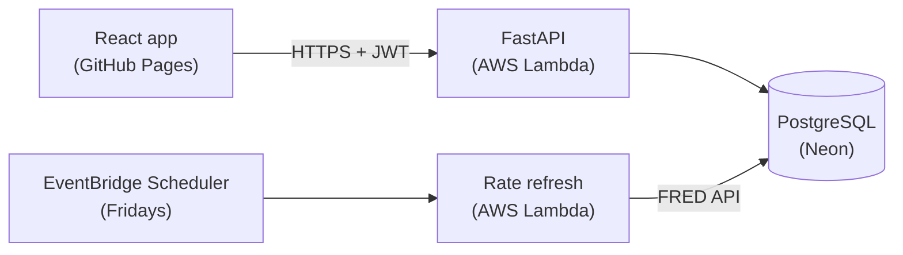

# BudgetProj

A budgeting and affordability app. Build a monthly budget with suggestions based on the 50/30/20 rule, then see how much home and car you can afford using current interest rates from the Federal Reserve, and how those payments would fit your budget.

**Live demo:** [marvinh0913.github.io/budgetProj](https://marvinh0913.github.io/budgetProj/)

## Features

- **Budget analysis.** Track income and expenses by category, with a spending breakdown and 50/30/20 suggestions. Runs entirely in the browser, in Python via Pyodide (WebAssembly).
- **Affordability estimates.** Maximum home and car prices based on the 28/36 and 20/4/10 guidelines, including estimated property taxes and insurance.
- **Budget impact chart.** Compares your current budget with the estimated mortgage or car payment, replacing rent in the home scenario.
- **Current interest rates.** Mortgage, federal funds, credit card, and auto loan rates from FRED, refreshed weekly by a scheduled job.
- **Optional accounts.** Every feature works without logging in. An account saves your financial profile.

## Architecture



- **Frontend:** React and Vite, deployed to GitHub Pages. The budget tools run client-side with Pyodide.
- **Backend:** FastAPI on AWS Lambda through a Function URL, adapted with Mangum. Handles accounts, profiles, transactions, rates, and affordability calculations.
- **Database:** PostgreSQL on Neon, with SQL migrations tracked in a `schema_migrations` table.
- **Rate refresh:** a second Lambda function, run weekly by EventBridge Scheduler, stores the latest FRED values.

## Tech Stack

| Area | Tools |
|---|---|
| Frontend | React, Vite, React Router, Chart.js, Pyodide |
| Backend | Python, FastAPI, Pydantic, psycopg 3 |
| Database | PostgreSQL (Neon) |
| Auth | JWT (PyJWT), Argon2 password hashing (pwdlib) |
| Cloud | AWS Lambda, EventBridge Scheduler, IAM, CloudWatch Logs |
| CI/CD | GitHub Actions with OIDC (no stored AWS keys) |
| Testing | Vitest, React Testing Library, pytest |
| Quality | ESLint, Prettier, Black, flake8 |

## API

| Method | Endpoint | Auth | Description |
|---|---|---|---|
| `POST` | `/auth/register` | | Create an account, returns a token |
| `POST` | `/auth/login` | | Log in, returns a token |
| `GET` | `/auth/me` | Required | Current user |
| `GET` / `PUT` | `/profile` | Required | Read or save income, debts, and savings |
| `GET` / `POST` | `/transactions` | Required | List or add transactions |
| `DELETE` | `/transactions/{id}` | Required | Delete a transaction |
| `GET` | `/rates` | | Latest interest rates |
| `GET` | `/affordability` | Required | Estimates from the saved profile |
| `POST` | `/affordability/estimate` | | Estimates without an account (nothing stored) |
| `GET` | `/health`, `/health/db` | | Health checks |

### External APIs

- **[FRED](https://fred.stlouisfed.org/docs/api/fred/)**: the backend's weekly refresh job pulls the latest values for `MORTGAGE30US`, `FEDFUNDS`, `TERMCBCCALLNS`, and `TERMCBAUTO48NS` and stores them in PostgreSQL. The frontend never calls FRED directly, so the API key stays on the server.

Interactive API docs are available at `/docs` on a running backend.

## Project Structure

```
budgetProj/
├── frontend/          React app (Vite)
│   ├── src/           Components, pages, services, Python (Pyodide)
│   └── tests/         Vitest and pytest tests
├── backend/           FastAPI app
│   ├── app/           Routes, models, services, config
│   ├── migrations/    SQL migrations
│   ├── scripts/       Migrations, rate refresh, Lambda packaging
│   ├── infra/         IAM policy documents
│   └── tests/         pytest tests
└── .github/workflows/ CI, backend deploy, and GitHub Pages deploy
```

## Getting Started

### Prerequisites

- Node.js 20+
- Python 3.11+
- A PostgreSQL database (a free [Neon](https://neon.tech) project works)
- A free [FRED API key](https://fred.stlouisfed.org/docs/api/api_key.html)

### Backend

```bash
cd backend
python3 -m venv .venv
source .venv/bin/activate
pip install -r requirements-dev.txt
cp .env.example .env              # then fill in your values
python -m scripts.migrate          # create the tables
python -m scripts.refresh_rates    # load current rates
uvicorn app.main:app --reload      # http://127.0.0.1:8000/docs
```

| Variable | Description |
|---|---|
| `DATABASE_URL` | PostgreSQL connection string |
| `JWT_SECRET` | Random secret for signing login tokens |
| `FRED_API_KEY` | FRED API key |

### Frontend

```bash
cd frontend
npm install
cp .env.example .env               # set VITE_API_URL=http://127.0.0.1:8000
npm run dev                        # http://localhost:5173
```

| Variable | Description |
|---|---|
| `VITE_API_URL` | Backend URL |

Never commit `.env` files.

## Testing

```bash
# Frontend
cd frontend
npm run lint
npx vitest run
python -m pytest                   # Pyodide budget calculations

# Backend
cd backend
black --check app scripts tests
flake8 app scripts tests
python -m pytest
```

## Deployment

Every push to `main` runs CI: linting, formatting checks, and tests for both sides. The backend tests run against a real PostgreSQL container, with migrations applied from scratch.

- **Backend:** after the backend tests pass, a deploy job builds the Lambda package, authenticates to AWS through GitHub's OIDC provider (short-lived credentials, scoped by IAM to this repository's `main` branch and to updating the two Lambda functions), deploys both functions, and runs a smoke test against the live API.
- **Frontend:** built with Vite and published to GitHub Pages. A `404.html` copy of `index.html` lets page reloads work on client-side routes.

Production secrets live only in the Lambda environment, never in GitHub.

## License

MIT